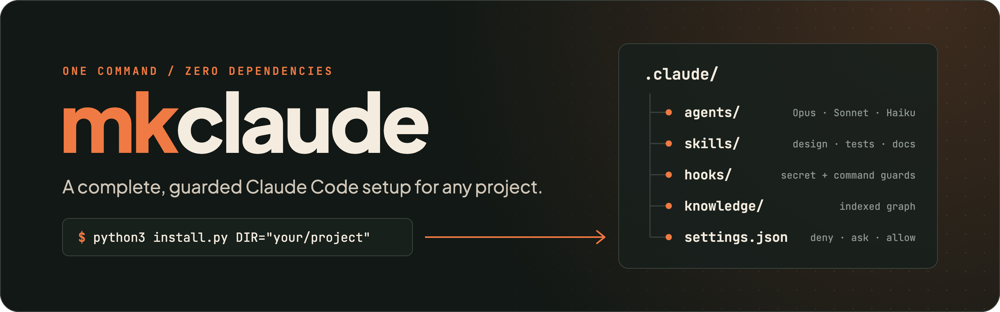

<p align="center">
  
</p>

<h1 align="center">🪄 mkclaude</h1>

<p align="center">
  <a href="https://github.com/meghamahna/mkclaude/actions/workflows/ci.yml"></a>
  <a href="#-requirements"></a>
  <a href="LICENSE"></a>
  <a href="#-requirements"></a>
  <a href="#-requirements"></a>
  <a href="CONTRIBUTING.md"></a>
</p>

**Set up Claude Code in any project with one command.** mkclaude writes a complete, opinionated `.claude/` folder: model-tiered agents, skills, guards against leaked secrets and destructive commands, a knowledge graph, and a context budget for every agent.

```bash
git clone https://github.com/meghamahna/mkclaude.git ~/mkclaude
python3 ~/mkclaude/install.py DIR="/path/to/your/project"
```

Plain Python, no dependencies. It merges with your existing Claude Code setup, and `--uninstall` removes it again.

<!-- toc -->
## 📑 Contents

- [Highlights](#-highlights)
- [Requirements](#-requirements)
- [Quick start](#-quick-start)
- [What gets installed](#-what-gets-installed)
- [Using it day to day](#-using-it-day-to-day)
- [Security model](#-security-model)
- [Update and uninstall](#-update-and-uninstall)
- [Documentation](#-documentation)
- [Roadmap](#-roadmap)
- [Contributing](#-contributing)
- [License](#-license)

<!-- /toc -->

## ⭐ Highlights

| Feature | What you get |
|---|---|
| **Agents** | 13 subagents in three model tiers: Opus codes and supervises, Sonnet writes docs and diagrams, Haiku does cheap lookups. |
| **Skills** | 16 skills for design, testing, security, docs, diagrams and token use. |
| **Secret and PII guards** | Blocked in prompts, file reads, writes, shell commands and web calls. Ordinary project files still work. |
| **Command guards** | `rm -rf`, force-push, `reset --hard`, `terraform destroy` and similar commands are blocked. |
| **Knowledge graph** | An index of the project that Claude reads before searching, and keeps up to date. |
| **Context budget** | Each agent hands off to a fresh one at 75% of its context. |

## 📦 Requirements

- [Claude Code](https://docs.anthropic.com/en/docs/claude-code), tested with 2.1.325.
- Python 3.9 or newer as `python3`. Standard library only: no pip, node or jq.
- macOS or Linux. CI tests both; Windows is untested.
- Git, recommended. The knowledge graph uses commit hashes to spot stale entries.

## 🚀 Quick start

1. **Preview.** Prints every action and changes nothing:

   ```bash
   python3 ~/mkclaude/install.py DIR="/path/to/your/project" --dry-run
   ```

2. **Install.** Detects your stack, writes `.claude/`, `CLAUDE.md` and `AGENTS.md`, and self-tests every guard:

   ```bash
   python3 ~/mkclaude/install.py DIR="/path/to/your/project"
   ```

3. **Check.** Open `claude` in the project and run `/harness-doctor`. Run `/kg-bootstrap` once to build the knowledge graph in depth.

4. **Describe and commit.** Replace the `TODO(human)` line in `CLAUDE.md` with one paragraph on the project, then commit so your team gets it:

   ```bash
   git add .claude CLAUDE.md AGENTS.md .gitignore && git commit -m "chore: add mkclaude"
   ```

## 📁 What gets installed

```
your-project/
├── CLAUDE.md              # harness block between <!-- harness:start/end -->; your content is kept
├── AGENTS.md              # agent roster, routing, protocols (readable by any agent tool)
└── .claude/
    ├── settings.json      # deny/ask/allow rules, hooks, sandbox, status line (merged with yours)
    ├── harness.json       # tunables: context %, scan limits, KG limits
    ├── agents/            # 13 subagents
    ├── skills/            # 16 skills
    ├── hooks/             # security, context-budget and knowledge-graph hooks
    ├── tools/             # kg.py, save.py, cleanup.py, doctor.py and helpers
    ├── security/allowlist # human-only detector exceptions
    └── knowledge/         # INDEX.md → nodes/*.md → exact path:line answers
```

Your settings win on merge, a `.bak` copy is written first, and a file you changed is never overwritten silently.

## ⚡ Using it day to day

Work with Claude as usual. The harness shows up in these places:

| You see | What it means |
|---|---|
| Status line `ctx NN%/75%` | Context used by the current agent, and its hand-off limit. |
| `[harness:security] ... blocked` | A guard stopped a secret, PII or a dangerous command. It names the detector, never the value. |
| `[harness:context] WARN` / `LIMIT` | The agent is near or at its budget and will hand off. |
| `[harness:kg]` | A batch of edits is waiting, so knowledge-keeper updates the graph, last. |
| `[harness:cleanup]` | Temporary-looking files are left over, and the agent removes its own. |

| Command | Does |
|---|---|
| `/ask-me <question>` | Answers a code question cheaply, with `path:line` pointers, outside your main context. |
| `/clean-me-up` | Removes agent leftovers. Nothing git tracks is touched; removed files stay restorable. |
| `/harness-doctor` | Health check of the whole install. |
| `/handoff`, `/resume-handoff <file>` | Save a hand-off note and continue fresh after `/clear`. |
| `/safe-read <file>` | Shows a sensitive file with its values masked. |

## 🔒 Security model

Six hooks and 129 deny rules guard every prompt, read, write, shell command, web call and tool output. Several independent layers, so one gap doesn't expose everything.

- **Block messages** name the detector, never the value.
- **Placeholders pass.** `user@example.com`, test cards, `${VAR}` and local dev values are not flagged.
- **Git stays safe.** Push and rebase ask first; force-push and history rewrites are denied.
- **Exceptions are human-only**, in `.claude/security/allowlist`.

[docs/security.md](docs/security.md) has every guard, the detection rules and the [known limits](docs/security.md#-known-limits).

## 🔄 Update and uninstall

```bash
git -C ~/mkclaude pull && python3 ~/mkclaude/install.py DIR="/path/to/your/project"   # update
python3 ~/mkclaude/install.py DIR="/path/to/your/project" --uninstall                  # remove
```

Untouched files are refreshed, files you changed are skipped, and the security files are always restored to the release. Uninstall keeps your settings, your `CLAUDE.md` and `AGENTS.md` content, and the knowledge graph.

## 📚 Documentation

| Doc | Covers |
|---|---|
| [How it works](docs/how-it-works.md) | Agents and pipelines, skills, knowledge graph, context budget, other AI tools. |
| [Security model](docs/security.md) | Every guard, detection rules, git policy, locked files, known limits. |
| [Configuration](docs/configuration.md) | Installer options and every `harness.json` key. |
| [Troubleshooting](docs/troubleshooting.md) | Blocked commands, false positives, permission prompts, failing checks. |
| [Contracts](docs/contracts.md) | Paths, node format, hand-off schema, return block, detector names. |
| [Evals](evals/README.md) | Behavioral evals on real headless Claude Code sessions. |
| [Changelog](CHANGELOG.md) | Release notes. |

## 🎯 Roadmap

- **More AI agents:** native instruction files and guards for tools beyond Claude Code.
- **Windows support** and a Windows CI job.
- **Plugin packaging**, so mkclaude can also install as a Claude Code plugin.

## 🙋 Contributing

See [CONTRIBUTING.md](CONTRIBUTING.md) and the [Code of Conduct](CODE_OF_CONDUCT.md). Report vulnerabilities privately through the Security tab, as described in [SECURITY.md](SECURITY.md).

## 📜 License

mkclaude is released under [MIT](LICENSE) license.
